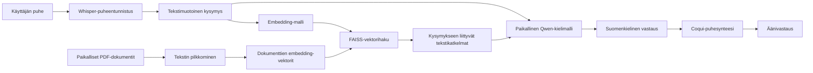

VÄÄRÄ DOI[](https://doi.org/10.5281/zenodo.23945518)


# Paikallinen suomenkielinen puhe-RAG PDF-aineistolle

Paikallisesti ajettava Python-pilotti, jonka avulla käyttäjä voi esittää puheella kysymyksiä omasta PDF-aineistostaan. Ohjelma litteroi kysymyksen paikallisella Whisper-mallilla, hakee kysymykseen liittyvät tekstikatkelmat FAISS-vektori-indeksistä, muodostaa vastauksen paikallisella kielimallilla ja lukee vastauksen ääneen suomenkielisellä puhesynteesillä.

Ratkaisu toimii mallien lataamisen jälkeen ilman pilvipalveluja. Käyttäjän puhetta, PDF-dokumentteja, tekstikatkelmia tai kielimallille annettavia kehotteita ei lähetetä ulkoisiin tekoälypalveluihin normaalin käytön aikana.

Pilotti on toteutettu osana **vAI:lla tuottavuutta?** -hanketta. Sen tarkoituksena on havainnollistaa, miten organisaation omia dokumentteja voidaan hyödyntää paikallisessa, puheohjattavassa tekoälysovelluksessa.

> Tämä on teknologiademo ja esimerkkitoteutus. Koodia ei ole sellaisenaan tarkoitettu tuotantokriittiseen käyttöön.

## Julkaisun historiatiedot

| Päivämäärä | Versio | Muutokset | Tekijä |
|---|---:|---|---|
| 20.11.2026 | 1.0 | Ensimmäinen julkaisu | Teemu Virtanen |
| 20.11.2026 | 1.1 | Mallilatausten rajaaminen tarvittaviin tiedostoihin | Teemu Virtanen |
| 20.11.2026 | 1.2 | Äänityksen toggle-ohjaus ja Coqui TTS -yhteensopivuuskorjaukset | Teemu Virtanen |
| xx.xx.2026 | 1.3 | Mahdollinen Zenodo-julkaisu | Teemu Virtanen |

## Sisällysluettelo

- [Teknologiapilotti](#teknologiapilotti)
- [Hanketiedot](#hanketiedot)
- [Kuvaus](#kuvaus)
- [Toimintaperiaate](#toimintaperiaate)
- [Käytettävät mallit ja teknologiat](#käytettävät-mallit-ja-teknologiat)
- [Tietosuoja ja paikallinen käyttö](#tietosuoja-ja-paikallinen-käyttö)
- [Tavoitteet](#tavoitteet)
- [Toteutetut toimenpiteet](#toteutetut-toimenpiteet)
- [Hakemistorakenne](#hakemistorakenne)
- [Asennus](#asennus)
- [Mallien lataaminen](#mallien-lataaminen)
- [PDF-aineiston lisääminen](#pdf-aineiston-lisääminen)
- [Ohjelman käyttäminen](#ohjelman-käyttäminen)
- [Asetukset](#asetukset)
- [Vianmääritys](#vianmääritys)
- [Vaatimukset](#vaatimukset)
- [Rajoitukset ja jatkokehitys](#rajoitukset-ja-jatkokehitys)
- [Tulokset](#tulokset)
- [Lisenssi](#lisenssi)
- [Tekijät](#tekijät)
- [Vastuuvapauslauseke](#vastuuvapauslauseke)

## Teknologiapilotti

vAI:lla tuottavuutta? -hankkeen työpaketti 2 tuottaa tuottavuuspilotteja. Tämä pilotti keskittyy **paikallisesti toimivaan, puheohjattavaan RAG-ratkaisuun**, joka hyödyntää käyttäjän omia PDF-dokumentteja.

RAG eli *Retrieval-Augmented Generation* tarkoittaa menetelmää, jossa kielimallille haetaan ensin kysymykseen liittyvää tietoa erillisestä tietokannasta. Kielimalli muodostaa vastauksensa sille annetun dokumenttikontekstin perusteella.

Tässä pilotissa tietokantana toimii paikallisista PDF-dokumenteista muodostettu FAISS-vektori-indeksi.

## Hanketiedot

- **Hankkeen nimi:** vAI:lla tuottavuutta?
- **Rahoittaja:** Euroopan unionin osarahoittama, Euroopan aluekehitysrahasto (EAKR) ja Etelä-Pohjanmaan liitto
- **Päätoteuttaja:** Seinäjoen Ammattikorkeakoulu Oy
- **Osatoteuttajat:** Tampereen korkeakoulusäätiö sr ja Vaasan yliopisto
- **Hankkeen aikataulu:** 1.8.2024–31.12.2026

## Kuvaus

Ohjelma käyttää välilyöntinäppäintä äänityksen käynnistämiseen ja lopettamiseen.

1. Käyttäjä painaa välilyöntiä kerran, jolloin äänitys käynnistyy.
2. Käyttäjä esittää kysymyksen mikrofoniin.
3. Käyttäjä painaa välilyöntiä uudelleen, jolloin äänitys päättyy.
4. Whisper muuntaa suomenkielisen puheen tekstiksi.
5. Kysymyksestä muodostetaan numeerinen embedding-vektori.
6. FAISS hakee PDF-aineistosta kysymystä parhaiten vastaavat tekstikatkelmat.
7. Haetut tekstikatkelmat annetaan paikalliselle Qwen-kielimallille.
8. Kielimalli muodostaa lyhyen suomenkielisen vastauksen.
9. Coqui TTS muuntaa vastauksen puheeksi.
10. Vastaus toistetaan tietokoneen äänilaitteella.

Kaikki varsinainen aineiston käsittely tapahtuu käyttäjän omalla tietokoneella.

## Toimintaperiaate



PDF-dokumenttien teksti jaetaan osittain päällekkäisiin tekstikatkelmiin. Päällekkäisyys auttaa säilyttämään asiayhteyden tilanteissa, joissa olennainen virke tai kappale sijoittuu kahden katkelman rajalle.

Hakutulokset suodatetaan samankaltaisuusarvon perusteella. Jos riittävän samankaltaista dokumenttikatkelmaa ei löydy, ohjelma ilmoittaa, ettei vastausta löytynyt paikallisista asiakirjoista.

## Käytettävät mallit ja teknologiat

| Käyttötarkoitus | Malli tai teknologia |
|---|---|
| Puheentunnistus | OpenAI Whisper Medium |
| Tekstien embedding-vektorit | `paraphrase-multilingual-MiniLM-L12-v2` |
| Vektorihaku | FAISS |
| Vastauksen muodostaminen | `Qwen2.5-1.5B-Instruct` |
| Suomenkielinen puhesynteesi | Coqui TTS `tts_models/fi/css10/vits` |
| PDF-tiedostojen lukeminen | PyPDF2 |
| Äänen tallennus ja toisto | SoundDevice ja SoundFile |
| Käyttöliittymä | Python-konsoli ja toggle-näppäinohjaus |

Ratkaisun keskeisiä Python-kirjastoja ovat:

- PyTorch
- Transformers
- Sentence Transformers
- FAISS
- OpenAI Whisper
- Coqui TTS 0.22.0
- PyPDF2
- NumPy
- SoundDevice
- SoundFile
- pynput

## Tietosuoja ja paikallinen käyttö

Ratkaisu on suunniteltu ympäristöihin, joissa dokumentteja tai puheaineistoa ei haluta lähettää ulkoisiin tekoälypalveluihin.

Normaalissa ajossa:

- PDF-dokumentit luetaan paikalliselta levyltä.
- Dokumenttien embedding-vektorit muodostetaan paikallisesti.
- FAISS-haku tehdään tietokoneen muistissa.
- Puheentunnistus suoritetaan paikallisella Whisper-mallilla.
- Kielimallin päättely suoritetaan paikallisesti.
- Puhesynteesi suoritetaan paikallisesti.
- Hugging Face -telemetria on poistettu käytöstä.
- Hugging Face -mallien verkkotarkistukset on estetty.
- Tavallisimmat Pythonin muodostamat verkkoyhteydet estetään ohjelmallisesti.
- Väliaikaiset äänitiedostot tallennetaan käyttöjärjestelmän väliaikaishakemistoon ja poistetaan käytön jälkeen.

Mallien ensimmäinen lataaminen tarvitsee verkkoyhteyden. Lataaminen tehdään erillisellä, käyttäjän tietoisesti käynnistämällä komennolla.

Arkaluonteisia PDF-tiedostoja, ladattuja malleja tai väliaikaisia äänitiedostoja ei tule lisätä Git-repositorioon. Projektin `.gitignore` estää niiden lisäämisen tavallisessa tilanteessa.

## Tavoitteet

Pilotin tavoitteena on:

- havainnollistaa paikallisen generatiivisen tekoälyn käyttöä organisaation omien dokumenttien kanssa;
- mahdollistaa PDF-aineistolle esitettävät suomenkieliset puhekysymykset;
- osoittaa, että puheentunnistus, dokumenttihaku, kielimalli ja puhesynteesi voidaan yhdistää samaan paikalliseen sovellukseen;
- tarjota muokattava referenssitoteutus jatkokehitystä varten;
- vähentää tarvetta siirtää luottamuksellista aineistoa ulkoisiin pilvipalveluihin;
- esitellä RAG-teknologian mahdollisia käyttökohteita yritysympäristössä.

Mahdollisia käyttökohteita ovat esimerkiksi:

- käyttö- ja huolto-ohjeiden kysely;
- sisäisten ohjeistusten hakeminen;
- perehdytysmateriaalien käyttö;
- laatujärjestelmän dokumentaatio;
- teknisten raporttien käsittely;
- kokousmuistioiden ja hankedokumenttien kysely;
- saavutettavuutta parantavat puhekäyttöliittymät.

## Toteutetut toimenpiteet

Pilotissa toteutettiin:

- mikrofonin toggle-tallennus;
- näppäimen automaattisen toiston esto;
- suomenkielinen puheentunnistus Whisper-mallilla;
- PDF-tiedostojen tekstisisällön lukeminen;
- tekstin jakaminen päällekkäisiin katkelmiin;
- dokumenttien embedding-vektorien muodostaminen;
- paikallinen FAISS-vektori-indeksi;
- kosinisamankaltaisuuteen perustuva dokumenttihaku;
- kysymykseen liittyvien tekstikatkelmien valinta;
- paikallinen vastausten muodostaminen Qwen-kielimallilla;
- RAG-kontekstiin kohdistuvien ohjeiden käsittely dokumenttitekstinä;
- suomenkielinen puhesynteesi;
- vastausäänen paikallinen toistaminen;
- erillinen mallien lataustila;
- normaalin käytön offline-suojaus;
- arkaluonteisten debug-tulosteiden poistaminen oletustilasta;
- mallilatausten rajaaminen tarvittaviin tiedostoihin;
- Coqui TTS 0.22.0 -yhteensopivuus;
- GitHub-julkaisua varten laadittu `.gitignore`.

## Hakemistorakenne

```text
local-rag-puhedemo/
├── local_rag_puhedemo.py
├── requirements.txt
├── README.md
├── .gitignore
├── tietokanta/             # Käyttäjän paikalliset PDF-tiedostot
└── models/                 # Paikallisesti ladatut mallit
```

Kansioita `tietokanta/` ja `models/` ei seurata Gitissä.

## Asennus

### Suositeltu Python-versio

Suositeltu Python-versio on **Python 3.10 tai 3.11**.

Sovelluksen asentamiseen tarvitaan:

- Python;
- Git;
- terminaali tai PowerShell;
- valinnaisesti Visual Studio Code;
- toimiva mikrofoni ja äänentoisto.

### Windows

Luo virtuaaliympäristö:

```powershell
python -m venv .venv
```

Aktivoi virtuaaliympäristö:

```powershell
.\.venv\Scripts\Activate.ps1
```

Päivitä pip ja asenna riippuvuudet:

```powershell
python -m pip install --upgrade pip
python -m pip install -r requirements.txt
```

### Linux

Luo ja aktivoi virtuaaliympäristö:

```bash
python3 -m venv .venv
source .venv/bin/activate
```

Asenna riippuvuudet:

```bash
python -m pip install --upgrade pip
python -m pip install -r requirements.txt
```

Linuxissa SoundDevice voi lisäksi tarvita käyttöjärjestelmän PortAudio- ja libsndfile-kirjastot.

## Mallien lataaminen

Mallit ladataan yhden kerran verkkoyhteyden aikana:

```powershell
python local_rag_puhedemo.py --download-models
```

Komento lataa:

- Qwen2.5-1.5B-Instruct-kielimallin;
- monikielisen Sentence Transformers -embedding-mallin;
- Whisper Medium -puheentunnistusmallin;
- suomenkielisen Coqui TTS -puhesynteesimallin.

Ladattavien mallien kokonaiskoko on noin **5 GB**.

Latauksen pääosat ovat:

| Malli | Arvioitu latauskoko |
|---|---:|
| Qwen2.5-1.5B-Instruct | noin 2,9 GB |
| Whisper Medium | noin 1,5 GB |
| Sentence Transformers -embedding-malli | noin 500 MB |
| Coqui TTS ja muut tiedostot | joitakin satoja megatavuja |

Embedding-mallista ladataan vain ohjelman tarvitsema PyTorch-versio. Vaihtoehtoisia ONNX-, OpenVINO- ja TensorFlow-mallipainoja ei ladata.

Latauksen tarkka koko voi muuttua hieman mallien julkaisijoiden tekemien päivitysten seurauksena.

Mallit tallennetaan oletuksena projektin paikalliseen `models/`-kansioon. Mallien lataamisen jälkeen sovellusta voidaan käyttää ilman verkkoyhteyttä.

## PDF-aineiston lisääminen

Luo projektin juureen kansio:

```text
tietokanta
```

Kopioi kyseltävät PDF-tiedostot tähän kansioon:

```text
local-rag-puhedemo/
└── tietokanta/
    ├── kayttoohje.pdf
    ├── huolto-ohje.pdf
    └── laatukasikirja.pdf
```

PDF-tiedostoja ei lisätä Git-repositorioon, koska `tietokanta/` on määritelty `.gitignore`-tiedostossa.

Ohjelma lukee kaikki kansion `.pdf`-tiedostot käynnistyksen yhteydessä ja muodostaa niistä uuden FAISS-indeksin.

## Ohjelman käyttäminen

Käynnistä sovellus:

```powershell
python local_rag_puhedemo.py
```

Kun mallit ja dokumentit on ladattu, ohjelma tulostaa esimerkiksi:

```text
SUOMENKIELINEN PAIKALLINEN PUHE-RAG
Laite: cuda
Verkkoyhteydet: estetty
Valmis: 125 tekstikatkelmaa

Paina välilyöntiä aloittaaksesi äänityksen.
Paina välilyöntiä uudelleen lopettaaksesi äänityksen.
Paina q lopettaaksesi.
```

Käyttö:

1. Paina välilyöntiä kerran.
2. Äänitys käynnistyy ja jatkuu automaattisesti.
3. Esitä kysymys mikrofoniin.
4. Paina välilyöntiä uudelleen.
5. Äänitys päättyy ja kysymyksen käsittely käynnistyy.
6. Odota paikallisen käsittelyn valmistumista.
7. Kuuntele ja lue vastaus.
8. Lopeta ohjelma painamalla `q`.

Välilyöntinäppäintä ei tarvitse pitää pohjassa. Näppäimen automaattinen toisto on estetty, joten yksi painallus vastaa aina yhtä käynnistys- tai lopetustoimintoa.

Esimerkkikysymyksiä:

- Milloin tämän laitteen suodatin pitää vaihtaa?
- Mitkä ovat tämän työvaiheen turvallisuusohjeet?
- Miten laite käynnistetään huollon jälkeen?
- Mitä raportissa sanotaan havaituista poikkeamista?
- Kuka vastaa hyväksymisestä?
- Mitä vaatimuksia dokumentissa asetetaan tarkastukselle?

## Asetukset

Ohjelman keskeisiä asetuksia voidaan muuttaa lähdekoodista:

```python
MAX_WORDS_PER_CHUNK = 120
CHUNK_OVERLAP = 40
TOP_K_CONTEXT = 3
MIN_SIMILARITY_SCORE = 0.35

MAX_INPUT_TOKENS = 1024
MAX_NEW_TOKENS = 128
```

Asetusten merkitys:

| Asetus | Kuvaus |
|---|---|
| `MAX_WORDS_PER_CHUNK` | Yhden PDF-katkelman enimmäispituus sanoina |
| `CHUNK_OVERLAP` | Peräkkäisten katkelmien päällekkäisten sanojen määrä |
| `TOP_K_CONTEXT` | Kielimallille annettavien hakutulosten enimmäismäärä |
| `MIN_SIMILARITY_SCORE` | Pienin hyväksyttävä hakutuloksen samankaltaisuusarvo |
| `MAX_INPUT_TOKENS` | Kielimallille annettavan syötteen enimmäispituus |
| `MAX_NEW_TOKENS` | Muodostettavan vastauksen enimmäispituus |

### Debug-tila

Litteroinnin ja valittujen PDF-katkelmien tarkastelu voidaan ottaa käyttöön:

```powershell
python local_rag_puhedemo.py --debug
```

Debug-tila voi tulostaa konsoliin:

- käyttäjän litteroidun kysymyksen;
- haetun PDF-tiedoston nimen;
- hakutuloksen samankaltaisuusarvon;
- haetun tekstikatkelman esikatselun.

Debug-tilaa ei suositella tilanteissa, joissa konsolin tulosteita tallennetaan lokiin tai näytetään muille käyttäjille.

### Mallikansion vaihtaminen

Mallien sijainti voidaan määrittää ympäristömuuttujalla:

```powershell
$env:LOCAL_RAG_MODELS_DIR = "D:\paikalliset-mallit"
python local_rag_puhedemo.py
```

### PDF-kansion vaihtaminen

PDF-aineiston sijainti voidaan määrittää ympäristömuuttujalla:

```powershell
$env:LOCAL_RAG_PDF_DIR = "D:\paikalliset-asiakirjat"
python local_rag_puhedemo.py
```

Näin dokumenttiaineisto voidaan pitää kokonaan Git-repositorion ulkopuolella.

## Vianmääritys

### Mallit puuttuvat

Jos ohjelma ilmoittaa paikallisten mallien puuttuvan, suorita:

```powershell
python local_rag_puhedemo.py --download-models
```

Mallien lataaminen tarvitsee verkkoyhteyden.

### Vanha versio lataa tarpeettomia mallitiedostoja

Aiempi latausversio saattoi ladata embedding-mallista myös ONNX-, OpenVINO- ja TensorFlow-versiot, jolloin latauksen koko kasvoi noin yhdeksään gigatavuun.

Keskeytä vanha lataus tarvittaessa painamalla `Ctrl+C` ja suorita korjatulla koodilla:

```powershell
python local_rag_puhedemo.py --download-models
```

Korjattu lataus hyödyntää jo ladatut tarpeelliset tiedostot eikä lataa vaihtoehtoisia malliformaatteja.

Vanhan latauksen tarpeettomat tiedostot voivat jäädä paikalliseen embedding-mallin kansioon. Niitä ei tarvita ohjelman suorittamiseen.

### Coqui TTS -mallia ei löydy

Ohjelma tukee Coqui TTS -mallien tarkistuspisteitä seuraavissa muodoissa:

```text
*.pth
*.pth.tar
```

Suomenkielisen mallin tarkistuspiste voi olla esimerkiksi:

```text
model_file.pth.tar
```

Jos malli puuttuu, suorita:

```powershell
python local_rag_puhedemo.py --download-models
```

### PDF-tiedostoja ei löydy

Varmista, että:

- `tietokanta/`-kansio on olemassa;
- tiedoston pääte on `.pdf`;
- PDF ei ole salattu;
- ohjelmalla on tiedoston lukuoikeus.

### PDF:stä ei saada tekstiä

PyPDF2 lukee PDF-tiedostojen tekstikerrosta. Jos PDF sisältää vain skannattuja kuvia, tekstiä ei voida käsitellä ilman OCR-toimintoa.

Skannattujen PDF-tiedostojen OCR-käsittely on jätetty jatkokehitykseen.

### Vastausta ei löydy

Mahdollisia syitä:

- kysymystä vastaavaa tietoa ei ole dokumenteissa;
- PDF:n tekstikerrosta ei voitu lukea;
- samankaltaisuuskynnys on liian korkea;
- tekstikatkelmat ovat liian pitkiä tai lyhyitä;
- kysymyksen sanamuoto eroaa merkittävästi dokumentin sanastosta.

Tarvittaessa säädä asetusta:

```python
MIN_SIMILARITY_SCORE = 0.35
```

Liian matala arvo voi kuitenkin tuoda kielimallille asiaan liittymättömiä tekstikatkelmia.

### Mikrofoni ei toimi

Tarkista:

- käyttöjärjestelmän mikrofonioikeudet;
- oletusäänilaite;
- mikrofonin näytteenottotaajuus;
- SoundDevice- ja PortAudio-asennukset;
- ettei toinen ohjelma käytä mikrofonia yksinoikeudella.

### Näppäinohjaus ei toimi

`pynput` kuuntelee välilyönti- ja `q`-näppäimiä käyttöjärjestelmän näppäinkuuntelun kautta.

Windowsissa tarkista, ettei toinen sovellus estä globaalia näppäinkuuntelua.

Linuxin Wayland-ympäristössä globaali näppäinkuuntelu voi vaatia lisäasetuksia tai vaihtoehtoisen käyttöliittymäratkaisun.

### CUDA-muisti loppuu

Jos GPU-muisti ei riitä:

- sulje muut GPU:ta käyttävät ohjelmat;
- käytä pienempää Whisper- tai kielimallia;
- pienennä syötteen enimmäispituutta;
- suorita mallit CPU:lla;
- ota käyttöön kielimallin kvantisointi jatkokehityksenä.

## Vaatimukset

### Laitteisto

Suositus:

- 64-bittinen Windows- tai Linux-tietokone;
- vähintään 16 GB RAM-muistia;
- vähintään noin 10 GB vapaata levytilaa;
- toimiva mikrofoni;
- toimiva äänentoisto;
- valinnainen NVIDIA GPU.

Vaikka ladattavien mallien koko on noin 5 GB, virtuaaliympäristö, Python-kirjastot, väliaikaiset lataustiedostot ja mahdolliset välimuistit tarvitsevat lisää levytilaa. Tämän vuoksi noin 10 GB vapaata levytilaa on suositeltava vähimmäismäärä.

GPU nopeuttaa Whisper-puheentunnistusta, embedding-laskentaa, kielimallin päättelyä ja puhesynteesiä. Sovellusta voidaan ajaa myös CPU:lla, mutta vastausten muodostaminen voi olla huomattavasti hitaampaa.

### Ohjelmisto

- Python 3.10 tai 3.11
- Git
- pip
- valinnaisesti Visual Studio Code
- valinnaisesti uv tai Conda

### Python-kirjastot

Riippuvuudet on määritelty `requirements.txt`-tiedostossa:

- `accelerate>=0.26`
- `TTS==0.22.0`
- `faiss-cpu`
- `huggingface-hub`
- `numpy`
- `openai-whisper`
- `pynput`
- `PyPDF2`
- `sentence-transformers`
- `sounddevice`
- `soundfile`
- `torch`
- `transformers>=4.37`

## Rajoitukset ja jatkokehitys

Nykyisen pilotin rajoituksia:

- PDF-indeksi muodostetaan uudelleen jokaisella käynnistyskerralla.
- Skannattuja PDF-tiedostoja ei tunnisteta ilman OCR-toimintoa.
- Taulukoiden, kuvien ja kaavioiden tulkinta on rajallista.
- Vastauksissa ei vielä esitetä varsinaisia lähdeviitteitä tai sivunumeroita.
- Käyttöliittymä perustuu konsoliin ja näppäinohjaukseen.
- Mallien lataaminen tarvitsee ensimmäisellä kerralla verkkoyhteyden.
- CPU-käyttö voi olla hidasta.
- Pieni kielimalli voi tehdä tulkintavirheitä.
- Ratkaisu ei korvaa alkuperäisten dokumenttien tarkistamista.
- Ohjelmaa ei ole tarkoitettu turvallisuuskriittisten päätösten ainoaksi tietolähteeksi.

Mahdollisia jatkokehityskohteita:

- FAISS-indeksin tallentaminen levylle;
- dokumenttien automaattinen muutosten tunnistus;
- OCR-tuki skannatuille dokumenteille;
- DOCX-, TXT-, Markdown- ja HTML-tiedostojen tuki;
- lähdetiedoston ja sivunumeron näyttäminen vastauksessa;
- graafinen käyttöliittymä;
- selainkäyttöliittymä paikallisessa verkossa;
- keskusteluhistorian hallinta;
- puheen automaattinen aloituksen ja lopetuksen tunnistus;
- vaihtoehtoiset kieli- ja embedding-mallit;
- mallien kvantisointi;
- käyttäjä- ja käyttöoikeushallinta;
- salattu dokumenttivarasto;
- Docker-paketointi;
- automatisoidut testit;
- suorituskykymittaukset eri laitteistoilla.

## Tulokset

Pilotti osoittaa, että samalla paikallisella Python-sovelluksella voidaan yhdistää:

- suomenkielinen puheentunnistus;
- omien PDF-dokumenttien semanttinen haku;
- RAG-menetelmään perustuva vastausten muodostaminen;
- paikallinen kielimalli;
- suomenkielinen puhesynteesi;
- offline-käyttöä tukeva tietosuojamalli.

Ratkaisu tarjoaa lähtökohdan organisaation omiin aineistoihin perustuvalle puheavustajalle. Tulosten laatu riippuu muun muassa dokumenttien laadusta, käytettävistä malleista, kysymysten sanamuodoista sekä hakukynnyksen ja tekstikatkelmien asetuksista.

Pilotin tarkoituksena ei ole osoittaa valmista tuotantojärjestelmää, vaan tehdä paikallisen generatiivisen tekoälyn mahdollisuudet konkreettisesti arvioitaviksi.

## Lisenssi

Projektin oma lähdekoodi ja dokumentaatio julkaistaan MIT-lisenssillä, ellei repositoriossa ilmoiteta toisin.

Käytettävät kirjastot ja ladattavat tekoälymallit ovat omien lisenssiensä alaisia. Käyttäjän tulee tarkistaa niiden lisenssiehdot ennen kaupallista käyttöä tai mallipainojen uudelleenjakelua.

PDF-aineisto ja ladatut mallipainot eivät sisälly projektin MIT-lisenssiin eikä niitä jaeta tämän repositorion mukana.

## Tekijät

**Teemu Virtanen**  
Koodi ja dokumentaatio

**vAI:lla tuottavuutta? -hanketiimi / SeAMK**

## Vastuuvapauslauseke

Tämä ohjelmisto on tutkimus-, kokeilu- ja demonstraatiokäyttöön tarkoitettu teknologiademo. Ohjelmiston tuottamat vastaukset voivat olla puutteellisia tai virheellisiä. Käyttäjän tulee tarkistaa olennaiset tiedot alkuperäisistä dokumenteista.
